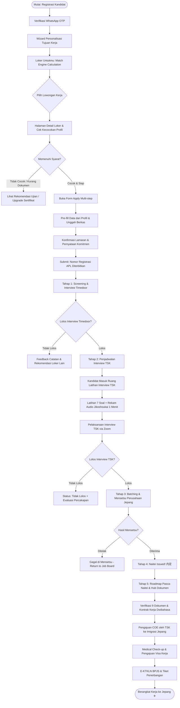
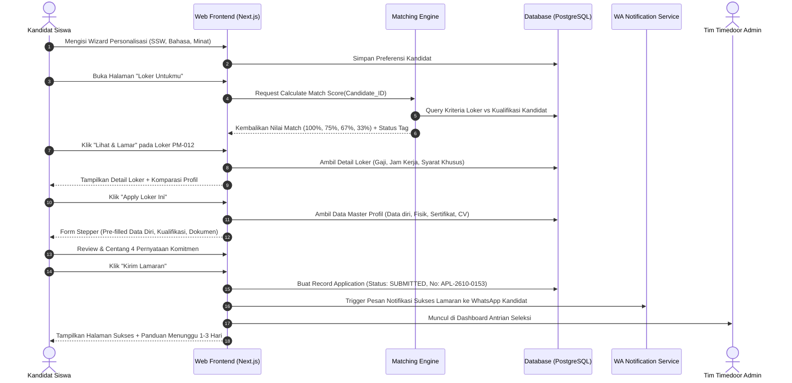
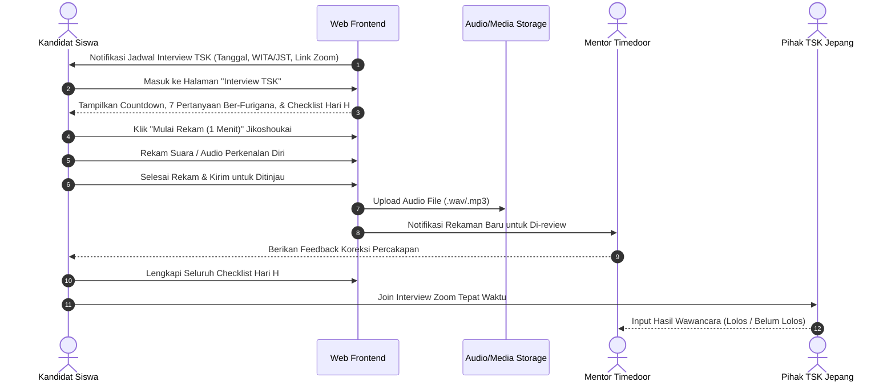
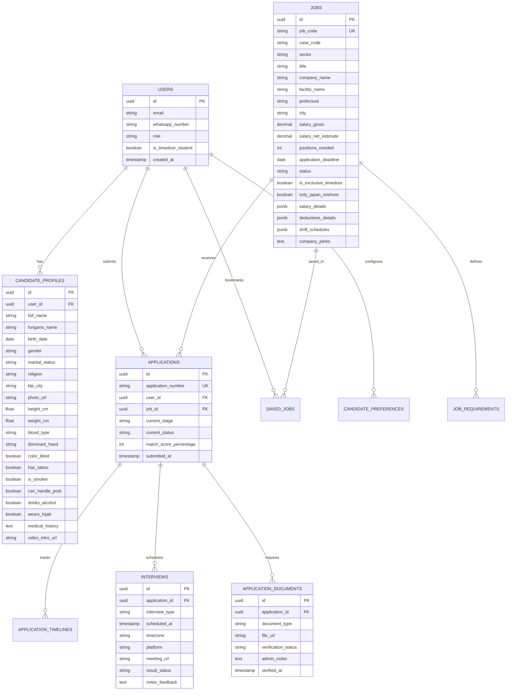
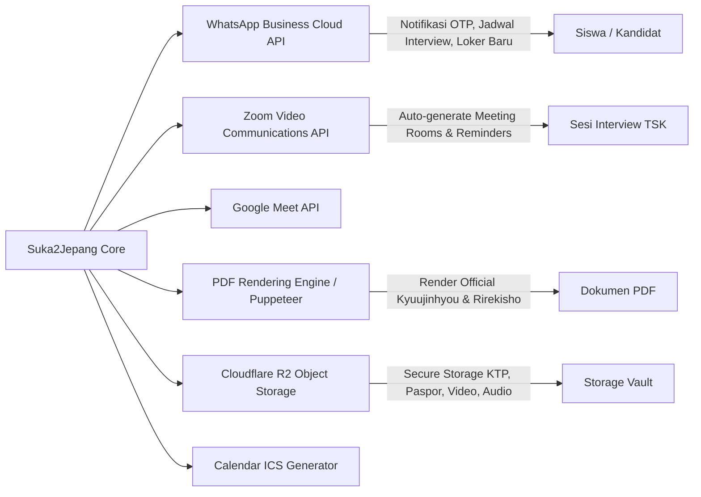
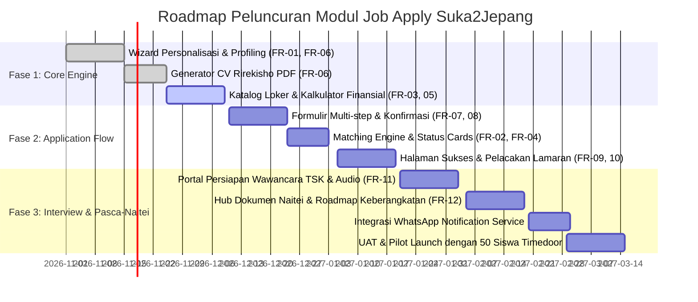

# PRD — Modul Penyaluran Kerja & Lamaran Loker (Job Apply)
## Platform Suka2Jepang (LPK Timedoor)

| Metadata Dokumen | Keterangan |
| :--- | :--- |
| **Produk / Modul** | Modul Penyaluran Kerja ke Jepang (Job Apply & Matching Engine) |
| **Platform** | Suka2Jepang (LPK Timedoor Indonesia) |
| **Versi Dokumen** | 1.0.0 (Comprehensive Specification) |
| **Status** | Approved / Ready for Engineering & QA |
| **Tanggal Terbit** | 20 Oktober 2026 |
| **Target Pengguna** | Siswa LPK Timedoor, Alumni, dan Kandidat Pekerja Migran Indonesia (SSW & Gijinkoku) |
| **Acuan Desain** | 12 Aset Visual (`Job Apply/*.jpg`) & Design System Tokens (`DESIGN.md`) |

---

## 1. Ringkasan Eksekutif & Latar Belakang (Executive Summary)

### 1.1 Latar Belakang
Program penempatan kerja ke Jepang melalui skema **Tokutei Ginou (Specified Skilled Worker / SSW)** dan **Gijinkoku (Engineer / Specialist in Humanities / International Services)** menghadapi tantangan transparansi informasi, ketidakcocokan kualifikasi (*mismatch*), serta panjangnya proses birokrasi seleksi yang melibatkan kandidat di Indonesia, LPK Timedoor di Indonesia, TSK (*登録支援機関 / Touroku Shien Kikan*) di Jepang, dan perusahaan penerima (*受入企業 / Ukeire Kigyou*).

Kandidat sering kali mengalami:
1. Ketidakjelasan rincian pemotongan gaji bersih (*take-home pay*) di Jepang (biaya asrama, pajak, asuransi kesehatan, shakai hoken).
2. Minimnya persiapan saat menghadapi wawancara bahasa Jepang dengan TSK (*Interview TSK*) dan wawancara direksi Jepang (*Mensetsu*).
3. Pengelolaan dokumen pasca-diterima (*Naitei*) yang berantakan sehingga memperlambat terbitnya *Certificate of Eligibility* (COE) dan visa kerja.

### 1.2 Tujuan Produk (Product Objectives)
Modul **Job Apply Suka2Jepang** bertujuan menjadi portal penyaluran kerja terintegrasi yang:
- **Transparan & Akurat:** Menampilkan lembar kerja (*求人票 / Kyuujinhyou*) resmi dengan simulasi gaji kotor vs. potongan wajib vs. gaji bersih secara transparan.
- **Matching Berbasis Profil:** Memiliki mesin pencocokan (*Job Matching Engine*) otomatis antara profil kandidat (sertifikat SSW, tingkat bahasa Jepang JLPT/JFT, kondisi fisik/kebiasaan) dengan kriteria perusahaan.
- **Rirekisho Otomatis:** Membangun *Single Source of Truth* profil siswa yang otomatis diekspor menjadi format CV resmi Jepang (*履歴書 / Rirekisho* format Timedoor).
- **End-to-End Pipeline Tracking:** Memandu kandidat secara terstruktur dari pendaftaran loker, tes awal, interview TSK dengan latihan audio, hingga pengumpulan 9 dokumen wajib pasca-Naitei menuju keberangkatan.

### 1.3 Key Performance Indicators (KPIs)
- **Tingkat Kelengkapan Profil (Profile Completion Rate):** $\ge 85\%$ kandidat aktif melengkapi data & video perkenalan.
- **Matching Accuracy:** $\ge 90\%$ kandidat yang melamar berstatus minimal $75\%$ cocok (*fit score*).
- **Kehadiran Wawancara (Interview Show-up Rate):** $\ge 95\%$ kandidat hadir tepat waktu pada sesi wawancara TSK / Mensetsu.
- **Time to COE Submission:** Waktu pengumpulan dokumen pasca-Naitei berkurang dari rata-rata 45 hari menjadi $\le 14$ hari kerja.

---

## 2. Aktor & Matriks Hak Akses (User Personas & RBAC)

| Peran (Role) | Deskripsi | Hak Akses Utama |
| :--- | :--- | :--- |
| **Kandidat / Siswa (Student)** | Siswa LPK Timedoor atau pendaftar umum yang mencari pekerjaan di Jepang. | - Mengisi wizard personalisasi & preferensi loker.<br>- Mengelola data profil, fisik, sertifikat, & video jikoshoukai.<br>- Mengunduh CV Rirekisho (PDF).<br>- Melakukan filter & melamar lowongan kerja.<br>- Memantau status tahapan lamaran (5 tahap).<br>- Mengakses latihan interview & perekam audio.<br>- Mengunggah 9 dokumen pasca-Naitei. |
| **Admin / Recruiter Timedoor** | Staf penempatan LPK Timedoor Indonesia. | - Verifikasi sertifikat bahasa (JLPT/JFT) & SSW.<br>- Mengatur jadwal & melakukan wawancara awal Timedoor.<br>- Mengubah status kelulusan kandidat ke tahap TSK.<br>- Memvalidasi keabsahan dokumen pasca-Naitei.<br>- Berkomunikasi langsung via WhatsApp dengan kandidat. |
| **TSK Partner (登録支援機関)** | Mitra TSK resmi di Jepang yang mendampingi pekerja SSW. | - Menerima berkas lamaran dan CV Rirekisho terstandarisasi.<br>- Melakukan interview kesiapan kerja & bahasa Jepang.<br>- Mengatur jadwal Mensetsu dengan perusahaan penerima.<br>- Membantu pengajuan permohonan COE ke Imigrasi Jepang. |
| **Perusahaan Jepang (受入企業)** | Perusahaan pemilik lowongan (pabrik makanan, rumah sakit, panti lansia, dsb.). | - Menentukan kriteria lowongan (*Kyuujinhyou*).<br>- Melaksanakan wawancara akhir (*Mensetsu*).<br>- Menerbitkan surat penerimaan (*Naitei / 内定*) dan kontrak kerja dwibahasa. |

---

## 3. Peta Navigasi & Arsitektur Informasi

```
Portal Siswa (Suka2Jepang)
├── 1. Onboarding / Personalisasi (Wizard)
│   ├── Step 1: Buat Akun
│   ├── Step 2: Verifikasi WhatsApp OTP
│   └── Step 3: Tujuan Kerja di Jepang (Visa, Bidang, Level Bahasa, WA Alert)
│
├── 2. Lowongan Kerja (Job Board)
│   ├── Tab "Untukmu" (Personalized Job Recommendations + Match %)
│   ├── Tab "Semua Lowongan" (Full Catalog + Filter Bidang, Prefektur, Domisili, Fasilitas)
│   ├── Widget Tersimpan (Bookmark Loker)
│   ├── Widget Notifikasi WhatsApp Loker Baru
│   └── Halaman Detail Lowongan (Bilingual View, Rincian Gaji & Potongan, Cek Kecocokan)
│
├── 3. Alur Lamaran Loker (Job Application Flow)
│   ├── Form Lamaran Stepper (Data Diri, Kualifikasi, Dokumen CV/Video)
│   ├── Konfirmasi Lamaran (Ringkasan, Validasi Syarat, Pernyataan Komitmen)
│   └── Status Sukses Kirim (Nomor Registrasi APL, Timeline, Panduan WA)
│
├── 4. Lamaran Saya (Application Tracking Dashboard)
│   ├── Tab Lamaran Aktif vs Selesai
│   ├── Kartu Status Pipeline 5 Tahap (Apply -> Interview Timedoor -> Interview TSK -> Mensetsu -> Naitei)
│   ├── Widget Jadwal Berikutnya (WITA/JST, Zoom/Meet)
│   ├── Modul Persiapan Interview TSK (Checklist Hari H, Latihan 7 Soal Furigana, Rekam Jikoshoukai)
│   └── Hub Pasca-Naitei (Roadmap 7 Tahap Keberangkatan & Verifikasi 9 Dokumen Wajib)
│
└── 5. Profil & CV (Single Source of Truth)
    ├── Data Pribadi & Pas Foto 3x4
    ├── Kesehatan & Fisik (Tato, Merokok, Babi, Shift Malam, Alkohol, Hijab)
    ├── Pendidikan & Pekerjaan
    ├── Bahasa & Sertifikat (Verifikasi JLPT/JFT/SSW)
    ├── Keluarga & Wali
    ├── Video Perkenalan (Jikoshoukai)
    └── Live Preview & Unduh CV Rirekisho (PDF)
```

---

## 4. End-to-End User Journey & Alur Sistem

### 4.1 Diagram Alur Global: Dari Registrasi hingga Keberangkatan ke Jepang



---

### 4.2 Sequence Diagram: Pengajuan Lamaran & Validasi Sistem



---

### 4.3 Sequence Diagram: Persiapan & Pelaksanaan Interview TSK



---

## 5. Spesifikasi Kebutuhan Fungsional per Halaman (Screens Specification)

Berdasarkan 12 aset visual pada direktori `Job Apply`, berikut rincian fungsional komprehensif untuk setiap layar:

```
Aset Referensi Visual:
1.  Personalize.jpg                -> FR-01: Wizard Personalisasi Preferensi Kerja
2.  Personalize job list.jpg       -> FR-02: Dashboard "Loker Untukmu" & Rekomendasi
3.  Job Application List.jpg       -> FR-03: Katalog Lowongan Kerja & Pencarian Global
4.  Card job status Variation.jpg  -> FR-04: Spesifikasi Status Kartu Lowongan
5.  Job Details.jpg                -> FR-05: Halaman Detail Lowongan & Kalkulator Finansial
6.  profile.jpg                    -> FR-06: Manajemen Profil & Generator CV Rirekisho
7.  Job Apply Stepper.jpg          -> FR-07: Formulir Pendaftaran Lamaran Bertahap
8.  Job Apply Stepper-1.jpg        -> FR-08: Langkah Konfirmasi & Pernyataan Kepatuhan
9.  Job Apply status after send.jpg-> FR-09: Halaman Sukses Registrasi Lamaran
10. Job Applied list.jpg           -> FR-10: Dashboard "Lamaran Saya" & Pipeline Pelacakan
11. Interview TSK.jpg              -> FR-11: Portal Persiapan & Simulasi Wawancara TSK
12. List Dokumen.jpg               -> FR-12: Hub Dokumen Pasca-Naitei & Roadmap Visa
```

---

### FR-01: Wizard Personalisasi Preferensi Kerja (`Personalize.jpg`)

| Komponen | Tipe Elemen | Aturan Bisnis & Spesifikasi |
| :--- | :--- | :--- |
| **Progress Stepper** | Horizontal Step | Menampilkan alur onboarding: (1) Buat akun [Selesai], (2) Verifikasi WhatsApp [Selesai], (3) Tujuan kerja [Aktif - Langkah 3 dari 3]. |
| **Judul & Deskripsi** | Heading & Text | "Kamu ingin kerja apa di Jepang?" dengan keterangan: "Jawabanmu dipakai untuk menampilkan loker yang cocok. Bisa diubah kapan saja." |
| **Pilihan Jenis Visa** | Radio Card Group | Opsi pilihan tunggal berbentuk kartu interaktif:<br>1. **Tokutei Ginou (SSW)**: Subtitle "Lulusan SMA/SMK, punya atau sedang siapkan sertifikat SSW".<br>2. **Gijinkoku**: Subtitle "Lulusan D3/S1, minimal JLPT N3".<br>3. **Belum tahu**: Subtitle "Admin akan bantu arahkan". |
| **Bidang yang Diminati** | Multi-select Chips | Pilihan kategori keahlian (bisa memilih lebih dari 1):<br>Pengolahan Makanan, Kaigo, Restoran, Perhotelan, Pertanian, Konstruksi, Manufaktur, Perawatan Mobil, Transportasi, Perikanan. |
| **Sertifikat SSW yang Dimiliki** | Single Dropdown | Pilihan status kelulusan: "Belum ada", atau daftar bidang SSW yang telah lulus ujian. |
| **Kemampuan Bahasa Jepang** | Single Dropdown | Pilihan: "Sedang belajar (belum ujian)", "JFT Basic A2", "JLPT N5", "JLPT N4", "JLPT N3", "JLPT N2/N1". |
| **Domisili Saat Ini** | Single Dropdown | "Indonesia" atau "Jepang" (kandidat *onshore* alih status). |
| **Sumber Informasi** | Single Dropdown | "Tahu Suka2Jepang dari": Grup Facebook, Instagram, Teman, LPK, Iklan, dll. |
| **Opt-in Notifikasi WhatsApp** | Checkbox | Centang *default on*: "Kirim info loker baru yang cocok ke WhatsApp saya". Menyimpan `whatsapp_job_alert = true`. |
| **Navigasi CTA** | Button Group | Tombol "Kembali" (Secondary outline) dan "Lihat loker untukku" (Primary Red `#C12121`). Menekan tombol utama menyimpan preferensi dan me-redirect ke FR-02. |

---

### FR-02: Dashboard "Loker Untukmu" & Rekomendasi (`Personalize job list.jpg`)

| Komponen | Spesifikasi & Logika Fungsional |
| :--- | :--- |
| **Header Ringkasan Profil** | Menampilkan judul "Loker untukmu" serta subjudul dinamis hasil sintesis profil: *"Dicocokkan dengan profilmu: [gender], [umur] th, [sertifikat SSW], [level bahasa], domisili [negara]."* |
| **Algoritma Persentase Kecocokan** | Komponen lencana lingkaran (*Circular Match Badge*) di sisi kiri kartu:<br>- **100% Cocok (Solid Red `#C12121`):** Memenuhi semua kriteria mandatori (SSW match, Level bahasa match, Usia match, Gender match, Domisili match).<br>- **75% Cocok (Light Pink Wash):** Memenuhi kualifikasi utama (bahasa & domisili), namun kurang 1 syarat non-kritis (misal: belum punya sertifikat SSW Kaigo namun ada N4).<br>- **67% Cocok (Light Pink Wash):** Memenuhi 2 dari 3 parameter pokok.<br>- **33% Cocok (Muted Gray Wash):** Memenuhi parameter dasar usia, namun belum memiliki sertifikat spesifik atau bukan eks-magang. |
| **Parameter Tags Komparasi** | Tag pill penanda kualifikasi dengan penanda visual status:<br>- `[✓ SSW sesuai]` (Hijau)<br>- `[✓ JLPT N4]` (Hijau)<br>- `[✓ Domisili Indonesia]` (Hijau)<br>- `[✗ Perlu SSW bidang terkait]` (Muted Cross Merah/Hitam)<br>- `[✗ Diutamakan mantan magang]` |
| **Aksi Kartu Loker** | Tombol Bookmark (ikon simpan) + Tombol CTA: Jika belum apply tampil tombol "Lihat loker" (Merah), jika sudah pernah apply tampil tombol disabled "Sudah apply" (Abu-abu). |
| **Widget Tersimpan (3)** | Sidebar kanan menampilkan daftar loker yang di-bookmark siswa beserta status kuota dan aksi cepat. |
| **Widget Notifikasi WhatsApp** | Card bertema gelap (*Dark Navy `#2B323D`*) menampilkan status langganan WA: Kategori yang dipantau, status toggle aktif [✓], dan link "Ubah preferensi ->". |
| **Widget Gamifikasi Peningkatan Peluang** | Card promosi edukasi: *"Lulus ujian SSW Kaigo membuka 74 loker tambahan tahun ini."* Dilengkapi link CTA "Lihat jadwal ujian ->" mengarah ke modul persiapan ujian Suka2Jepang. |

---

### FR-03: Katalog Lowongan Kerja & Pencarian Global (`Job Application List.jpg`)

| Komponen | Detail Spesifikasi |
| :--- | :--- |
| **Header & Bar Pencarian** | Judul: "Lowongan Kerja 求人" (dengan kanji Jepang), Subjudul: *"46 lowongan terbuka di Jepang · diperbarui [Tanggal]"*. Input pencarian global dengan placeholder *"Cari bidang, prefektur, kode loker"*. |
| **Banner Status Sertifikasi Siswa** | Banner hijau (*Pass Wash `#ECFDF5`* dengan ikon pita) bertuliskan: *"Job Matching Test • Certified - Kamu sudah bisa melamar semua lowongan yang sesuai dengan domisili dan kualifikasimu."* |
| **Sidebar Filter Lengkap** | 1. **Bidang Keahlian (Checklist + Kanji):** Kaigo (介護), Kensetsu (建設), Gijinkoku (技人国), Pengolahan Makanan (飲食料品製造), Restoran (外食), Manufaktur (製造業), Pertanian (農業).<br>2. **Prefektur (Dropdown):** "Semua prefektur", Hokkaido, Tokyo, Osaka, Kagoshima, dll.<br>3. **Domisili Pelamar (Radio):** "Sesuai domisili saya" (otomatis filter sesuai negara asal) atau "Tampilkan semua".<br>4. **Fasilitas & Karakteristik:** "Asrama tersedia", "Boleh berhijab", "Tanpa pengalaman".<br>5. **Tombol "Reset":** Mengembalikan semua parameter filter ke default. |
| **Header Grid & Pengurutan** | Total count ("46 lowongan ditemukan") + Dropdown sorting ("Urutkan: Terbaru", "Gaji Tertinggi", "Batas Waktu Terdekat"). |
| **Grid Kartu Lowongan** | Tata letak responsive grid (3 kolom desktop, 1 kolom mobile). Menampilkan informasi kunci: Kode Loker (PM-012, KG-089, EG-039), Kategori & Kanji, Nama Posisi, Nama Perusahaan / TSK, Lokasi Penempatan, Estimasi Gaji Bulanan, Kuota Posisi & Gender, Badge Fasilitas, serta Batas Waktu. |
| **Pagination** | Paginasi halaman numerik: `< 1 2 3 ... 8 >`. |

---

### FR-04: Standarisasi Status Kartu Lowongan (`Card job status Variation.jpg`)

Komponen terpadu `.job-card` mengonsumsi data dari spreadsheet / database dan merender 6 variasi status visual:

```
+---------------------------------------------------------------------------------------------------------+
|                               VARIASI STATUS KARTU LOWONGAN (.job-card)                                 |
+------------------------------+------------------------------+-------------------------------------------+
| 1. Default (Open)            | 2. Hampir Ditutup            | 3. Khusus Siswa Timedoor                  |
| - Belum pernah dilamar       | - Batas waktu <= 3 hari      | - Khusus pendaftar internal LPK           |
| - Footer: "Diterima [Tgl]"   | - Footer: "🕒 Tutup 3 hari"  | - Badge: "Khusus siswa Timedoor"          |
| - CTA: [Lihat & Lamar] (Red) | - CTA: [Lihat & Lamar] (Red) | - CTA: [Lihat & Lamar] (Red)              |
+------------------------------+------------------------------+-------------------------------------------+
| 4. Sudah Dilamar             | 5. Tidak Sesuai Domisili     | 6. Ditutup (Closed)                       |
| - Menampilkan status lamaran | - Kandidat di Indo, loker JP | - Batas waktu habis / kuota penuh         |
| - Strip: "✓ Dilamar 10 Okt"  | - Warning: "⚠️ Hanya tinggal | - Label: "Ditutup [Tanggal]"              |
|   "Tahap: Interview TSK"     |   di Jepang"                 | - CTA: [Ditutup] (Disabled Gray)          |
| - Counter: "2 dari 5 tahap"  | - Footer: "[X] posisi"       |                                           |
| - CTA: [Lihat status] (Outl) | - CTA: [Tidak bisa dilamar]  |                                           |
+------------------------------+------------------------------+-------------------------------------------+
```

1. **Default (Status Open):**
   - Lencana kategori dengan kode kasus, nama perusahaan, gaji kotor bulanan, jumlah posisi, tag fasilitas.
   - Tombol utama: "Lihat & Lamar" (Merah Hinomaru `#C12121`).
2. **Hampir Ditutup (Urgent $\le 3$ Hari):**
   - Menampilkan penanda peringatan waktu bertinta oranye/kuning *"🕒 Tutup 3 hari lagi"*.
   - Memicu urgensi pendaftaran sebelum kuota batch ditutup.
3. **Khusus Siswa Timedoor (Exclusive Role):**
   - Menampilkan badge gelap *Sumi Navy* `"Khusus siswa Timedoor"`. Lowongan ini hanya dapat di-submit oleh siswa terdaftar yang memiliki status `is_timedoor_student = true`.
4. **Sudah Dilamar (Applied State):**
   - Menampilkan bar informasi hijau muda (*Pass Wash `#ECFDF5`*): *"✓ Dilamar [Tanggal] · Tahap: [Tahap Aktif]"*.
   - Menampilkan teks progres: *"X dari 5 tahap"*.
   - Tombol aksi sekunder: "Lihat status" (White outline button) mengarahkan ke FR-10.
5. **Tidak Sesuai Domisili (Restricted Domicile):**
   - Diberlakukan untuk loker yang hanya menerima kandidat alih status yang sedang berada di Jepang (*Japan Onshore*).
   - Terdapat strip peringatan: *"⚠️ Hanya untuk pelamar yang tinggal di Jepang"*.
   - Tombol terkunci / disabled: *"Tidak bisa dilamar"*.
6. **Ditutup (Expired / Closed):**
   - Keterangan tanggal berakhir: *"Ditutup [Tanggal]"*.
   - Tombol disabled warna abu-abu netral: *"Ditutup"*.

---

### FR-05: Halaman Detail Lowongan & Kalkulator Finansial (`Job Details.jpg`)

| Bagian Halaman | Rincian Spesifikasi |
| :--- | :--- |
| **Top Bar & Language Switcher** | - Link kembali: "<- Semua loker".<br>- **Tri-state Language Switcher:** Pilihan `Indonesia` \| `日本語` \| `Dua bahasa` (menampilkan label dwibahasa secara bersandingan untuk transparansi terminologi kerja). |
| **Header Loker & Institusi** | - Badges: `Tokutei Ginou · Kaigo (介護)`, `Kedatangan baru dari luar negeri (新規入国)`.<br>- Kode Loker & Kasus: `KG-096 · Kode kasus K-2610167`.<br>- Judul: "Staf perawat lansia — Sapporo".<br>- Nama Organisasi & Fasilitas: Yayasan Medis Kojinkai (医療法人耕仁会) · Fasilitas "Sage Yamanote" (介護老人保健施設セージュ山の手), Nishi-ku, Sapporo, Hokkaido. |
| **4 Kartu Metrik Utama** | 1. **Gaji + Tunjangan:** `¥185.500`<br>2. **Perkiraan Bersih:** `¥134.628` (dihitung otomatis)<br>3. **Dibutuhkan:** `2 orang`<br>4. **Mulai Pendaftaran:** `9 Okt 2026` |
| **Daya Tarik Perusahaan** | Grid 6 poin keunggulan dengan ikon centang: Dukungan Pelatihan Praktisi (実務者研修) & Kaigo Fukushishi, seragam & asrama Wi-Fi, pesangon masa kerja $\ge 4$ tahun, libur 120 hari/tahun, cuti berbayar 10 hari setelah 3 bulan. |
| **Pekerjaan & Jam Kerja** | - Rincian deskripsi tugas harian: Bantuan makan/mandi/eliminasi, rehabilitasi harian, rekreasi.<br>- **Kartu Shift Kerja:**<br>  * Pagi 1: 07:30–16:10<br>  * Pagi 2: 07:50–16:30<br>  * Siang: 08:50–17:30<br>  * Sore 1: 10:00–18:40<br>- Catatan: Istirahat 60 menit, jam kerja resmi 7 jam 40 menit. Shift malam 4–6 kali per bulan setelah masa penyesuaian. |
| **Rincian Gaji & Simulasi Potongan (Kalkulator Finansial)** | **Tabel Komparasi 2 Kolom:**<br>**Kolom (a) Gaji & Tunjangan:**<br>- Gaji pokok: `¥145.500`<br>- Tunjangan perbaikan perlakuan (処遇改善手当): `¥33.500`<br>- Tunjangan perbaikan khusus (特定処遇改善手当): `¥6.500`<br>- **Total (1):** `¥185.500`<br><br>**Kolom (b) Potongan Wajib:**<br>- Pajak penghasilan (*Shotokuzei*): `¥2.360`<br>- Jaminan sosial (*Shakai Hoken*): `¥27.151`<br>- Asuransi ketenagakerjaan (*Koyou Hoken*): `¥943`<br>- Asrama (*Wi-Fi include*): `¥20.000`<br>- Iuran dukungan anak: `¥218`<br>- Iuran koperasi karyawan: `¥200`<br>- **Total (2):** `¥50.872`<br><br>**Banner Highlight Gaji Bersih:**<br>- `Perkiraan gaji bersih (1 - 2): ¥134.628` (Blok merah tegas Hinomaru Red).<br>- Tunjangan insidentil: Shift malam `¥10.000 / kali`, Bonus tahunan `3,55 bulan / tahun`, Lembur hari libur `¥1.000 / hari`. |
| **Syarat Pelamar (Tabel Parameter)** | Matriks 9 parameter kualifikasi:<br>1. Jenis kelamin: Perempuan<br>2. Rentang usia: 18–30 tahun<br>3. Bahasa Jepang: JLPT N4 ke atas<br>4. Kewarganegaraan: Indonesia<br>5. Kebijakan Hijab: Tidak boleh<br>6. Kebijakan Tato: Tidak boleh<br>7. Pengalaman di Jepang: Tidak wajib<br>8. Status Pernikahan: Bebas<br>9. SIM Kendaraan: Tidak wajib |
| **Sidebar Kanan: Evaluasi Kecocokan** | **Card "Cocok dengan profilmu?":**<br>- [✓] Usia 23 tahun — masuk rentang (Hijau)<br>- [✓] JLPT N4 — memenuhi (Hijau)<br>- [✓] Tidak bertato — memenuhi (Hijau)<br>- [!] Sertifikat SSW Kaigo belum ada (Lingkaran Hitam)<br>- **Tombol Utama:** "Apply loker ini" (Merah Hinomaru)<br>- **Tombol Dokumen:** "Download 求人票 (PDF)" (Mengunduh berkas lowongan resmi Jepang).<br>- **Card Libur & Cuti:** 120 hari libur, cuti berbayar 10 hari, tunjangan saat diliburkan perusahaan 60%. |

---

### FR-06: Manajemen Profil & Generator CV Rirekisho (`profile.jpg`)

| Komponen | Spesifikasi & Logika Fungsional |
| :--- | :--- |
| **Konsep Utama** | *"Isi sekali, dipakai untuk semua lamaran. CV 履歴書 dibuat otomatis dari data ini."* Menghilangkan friksi kandidat mengetik ulang data manual setiap melamar. |
| **Sub-navigasi Profil** | Navigasi menu vertikal dengan penanda centang status:<br>1. Data pribadi [✓]<br>2. Kesehatan & fisik [✓]<br>3. Pendidikan & pekerjaan [✓]<br>4. Bahasa & sertifikat [✓]<br>5. Keluarga [✓]<br>6. Video perkenalan [!] (Tanda seru jika video 1 menit belum diunggah). |
| **Bagian Data Pribadi** | - Slot Foto 3x4 formal latar putih (Upload image JPG/PNG dengan auto-cropper).<br>- Nama Lengkap (sesuai paspor).<br>- Nama Katakana / Furigana (フリガナ) untuk pelafalan nama oleh perusahaan Jepang.<br>- Tanggal Lahir (auto kalkulasi usia tahun berjalan).<br>- Status Pernikahan (Belum Menikah / Menikah / Cerai).<br>- Agama (Islam, Kristen, Hindu, Buddha, dll.).<br>- Kota Asal sesuai KTP (misal: Denpasar, Bali). |
| **Bagian Kesehatan & Fisik** | - Input numerik: Tinggi badan (cm), Berat badan (kg).<br>- Dropdown: Golongan Darah (A, B, AB, O), Tangan Dominan (Kanan / Kiri).<br>- **Checklist Kondisi Khusus Industri Jepang:**<br>  * Buta warna [ ]<br>  * Memiliki tato [ ]<br>  * Merokok [ ]<br>  * Bisa pegang daging babi [✓] (Krusial untuk industri pengolahan makanan)<br>  * Minum alkohol [ ]<br>  * Berhijab [ ]<br>- Textarea: Riwayat penyakit atau operasi (Wajib diisi; ketik *"Tidak ada"* jika nihil). |
| **Bagian Bahasa & Sertifikat** | List kartu sertifikasi dengan status badge verifikasi admin:<br>- `JFT Basic A2` (Skor & tanggal ujian) -> Badge: [Terverifikasi]<br>- `SSW Pengolahan Makanan` (Tanggal ujian) -> Badge: [Terverifikasi]<br>- `JLPT N4` -> Badge: [Menunggu cek]<br>- Tombol dashed: `+ Tambah sertifikat` (upload berkas bukti kelulusan). |
| **Live Preview & Download Rirekisho** | Widget sidebar kanan menampilkan miniatur format standar Rirekisho Jepang (*JIS standard format*) yang memuat foto formal, data diri, riwayat pendidikan & kerja (*学歴・職歴*). Dilengkapi tombol **"Download CV (PDF)"** (*Sumi Navy `#2B323D`*). |

---

### FR-07: Formulir Pengajuan Lamaran Bertahap (`Job Apply Stepper.jpg`)

| Komponen | Spesifikasi & Logika Fungsional |
| :--- | :--- |
| **Header & Auto-save** | Judul: "Apply loker [Kode Loker]", Subjudul: *"Isi data dengan jujur. Tim Timedoor akan menghubungi via WhatsApp untuk interview awal dalam 1–3 hari kerja."* Terdapat indikator di pojok kanan atas: *"Draf tersimpan otomatis"*. |
| **Indikator Stepper** | Visual progress bar 4 tahap: `1. Data diri` -> `2. Kualifikasi` -> `3. Dokumen` -> `4. Konfirmasi`. |
| **Bagian 1: Data Diri** | Otomatis terisi (*pre-filled*) dari database profil: Nama paspor, Katakana/Furigana, Tanggal lahir, Nomor WhatsApp, Jenis Kelamin (Radio card), Domisili (Di Indonesia / Di Jepang). Kandidat dapat mengubah data spesifik jika diperlukan. |
| **Bagian 2: Kualifikasi** | - Sertifikat SSW yang dimiliki (Dropdown).<br>- Tingkat Bahasa Jepang (Dropdown: JFT Basic A2, dsb.).<br>- Pendidikan Terakhir (SMA/SMK, D3, S1).<br>- Pengalaman kerja di Jepang (Belum pernah / Eks-Kenshusei / Eks-Ginou Jisshuusei).<br>- **Pertanyaan Khusus Perusahaan:**<br>  * Memiliki tato [ ]<br>  * Merokok [ ]<br>  * Bisa memegang daging babi [✓]<br>  * Bisa kerja shift malam [✓] |
| **Bagian 3: Unggah Dokumen** | 3 Kotak Area Unggah Interaktif (*Upload Slots*):<br>1. **CV (履歴書):** Wajib, format PDF maks 5MB (Bisa menggunakan CV auto-generated atau unggahan kustom).<br>2. **Sertifikat SSW / JFT:** Wajib, format PDF atau foto beresolusi tinggi.<br>3. **Video Perkenalan:** Opsional, durasi 1 menit dalam bahasa Jepang (*Jikoshoukai*). |
| **Pernyataan Persetujuan Data** | Checkbox wajib: *"Saya menyatakan data di atas benar dan setuju data saya dibagikan ke TSK/perusahaan untuk proses seleksi loker ini."* |
| **Sidebar Ringkasan Lowongan** | Menampilkan kartu loker ringkas (Gaji bulanan, kuota orang, tanggal batas apply merah) serta rincian 4 proses setelah apply (Interview Timedoor -> Interview TSK -> Mensetsu -> Naitei). |
| **Tombol Navigasi** | "Simpan draf" (Secondary button) dan "Kirim lamaran" / "Lanjut ke Konfirmasi" (Primary Red). |

---

### FR-08: Langkah Konfirmasi & Pernyataan Kepatuhan (`Job Apply Stepper-1.jpg`)

| Komponen | Spesifikasi & Logika Fungsional |
| :--- | :--- |
| **Stepper Status** | Tahap ke-4 aktif: `1. Data diri [✓]` - `2. Kualifikasi [✓]` - `3. Dokumen [✓]` - `4. Konfirmasi [Aktif]`. |
| **Banner Peringatan Integritas** | Kotak peringatan oranye (*Amber Alert*): *"Periksa sekali lagi. Setelah dikirim, data lamaran tidak bisa diubah sendiri — perubahan harus lewat admin."* |
| **Kartu Tinjauan Data (Review Cards)** | 3 kartu ringkasan terpisah dengan tombol pintasan **"Ubah"** di pojok kanan atas masing-masing:<br>1. **Data Diri:** Menampilkan nama, furigana, tanggal lahir & usia, gender, WhatsApp, domisili.<br>2. **Kualifikasi:** Menampilkan sertifikat SSW, level bahasa, pendidikan, pengalaman Jepang, status tato/merokok, serta kesiapan babi/shift malam.<br>3. **Dokumen Terlampir:** Menampilkan nama berkas asli (misal: `CV_Kandidat_2026.pdf`, `Sertifikat_SSW_JLPT-N4.pdf`, `jikoshoukai.mp4 (0:58)`). |
| **Evaluasi Kepatuhan Syarat Loker** | Card khusus bertajuk *"Kecocokan dengan syarat loker"* dengan lencana sukses `5 / 5 terpenuhi`:<br>- [✓] SSW Pengolahan makanan — Lulus<br>- [✓] JFT A2 / JLPT N4 — JLPT N4<br>- [✓] Domisili Indonesia / Jepang — Indonesia<br>- [✓] Pria atau wanita — Perempuan<br>- [✓] Siap shift malam (17:45–02:30) — Bisa |
| **Pernyataan Komitmen Kandidat** | **4 Checkbox Wajib (Semua wajib dicentang untuk mengaktifkan tombol kirim):**<br>1. [x] *"Saya menyatakan semua data dan dokumen di atas benar dan milik saya sendiri."*<br>2. [x] *"Saya setuju data saya dibagikan ke TSK dan perusahaan di Jepang untuk proses seleksi loker ini."*<br>3. [x] *"Saya bersedia mengikuti interview Timedoor, interview TSK, dan mensetsu sesuai jadwal."*<br>4. [x] *"Saya memahami mensetsu baru dijadwalkan setelah minimal 12 kandidat terkumpul."* (Aturan batching pendaftaran). |
| **Tombol Final** | - Tombol "<- Dokumen" (Kembali ke step 3).<br>- Tombol "Simpan draf".<br>- Tombol "Kirim lamaran" (Merah Hinomaru `#C12121`). Menekan tombol ini melakukan commit data ke server. |

---

### FR-09: Halaman Sukses Registrasi Lamaran (`Job Apply status after send.jpg`)

| Komponen | Spesifikasi & Logika Fungsional |
| :--- | :--- |
| **Ikon & Ucapan Sukses** | Ikon lingkaran centang merah besar (*Success Hero Icon*), Judul: **"Lamaranmu terkirim!"**, Subjudul: *"Terima kasih sudah apply [Kode Loker] · [Nama Posisi] di [Lokasi]."* |
| **Nomor Registrasi Lamaran** | Menampilkan kode referensi unik sistem: `Nomor lamaran: APL-2610-0153`. |
| **Milestone Alur Penanganan** | Timeline vertikal 4 tahapan status:<br>1. **Lamaran diterima sistem [Selesai/Centang]:** *"Hari ini, [Tanggal Submit]"*.<br>2. **Dihubungi tim Timedoor via WhatsApp:** *"Dalam 1–3 hari kerja untuk jadwal interview awal"*.<br>3. **Interview Timedoor:** *"Online 15–20 menit, pakai bahasa Jepang dasar"*.<br>4. **Interview TSK & mensetsu perusahaan:** *"Mensetsu dijadwalkan setelah minimal 12 kandidat terkumpul"*.<br>*(Kandidat langsung tahu apa yang akan terjadi tanpa perlu bertanya berulang kali).* |
| **Aksi Cepat Lanjutan** | - Tombol "Lihat status lamaran" (Primary Red) -> Mengarahkan ke FR-10.<br>- Tombol "Latihan interview" (Secondary Outline) -> Mengarahkan ke FR-11 untuk persiapan wawancara. |
| **Sidebar Ringkasan Berkas Terkirim** | Rekapitulasi singkat: Nama, Jenis Kelamin, Sertifikat, Bahasa, Domisili, dan daftar dokumen yang terkirim. |
| **Alert Verifikasi Kontak WhatsApp** | Box tint merah muda: *"Pastikan WhatsApp aktif. Tim Timedoor akan menghubungi dari nomor resmi [No WA admin loker]. Simpan nomornya supaya pesan tidak terlewat."* |
| **Rekomendasi Loker Sejenis** | Tautan rekomendasi loker lain di wilayah/bidang yang sama untuk meningkatkan rasio diterima kandidat (misal: *GU-001 · Staf gudang, Kagoshima ->*). |

---

### FR-10: Dashboard "Lamaran Saya" & Pipeline Pelacakan (`Job Applied list.jpg`)

| Komponen | Spesifikasi & Logika Fungsional |
| :--- | :--- |
| **Tab Filter Lamaran** | Tab pemisah status: **"Aktif (X)"** (default terisi angka badge lamaran yang sedang berjalan) dan **"Selesai (Y)"** (lamaran yang sudah Naitei atau Ditolak). |
| **Pipeline Status 5 Tahap (Visual Stepper)** | Setiap kartu lamaran memiliki visual bar progres 5 segmen:<br>`Apply` —— `Interview Timedoor` —— `Interview TSK` —— `Mensetsu` —— `Naitei` |
| **Kasus Status 1: Lolos Timedoor (Menuju TSK)** | - Kode & Posisi: `PM-012 · Pengolahan Makanan - Staf produksi makanan beku`<br>- Lencana Status: `Lulus interview Timedoor` (Merah muda wash).<br>- Bar Progres: Segmen 1 & 2 merah solid, segmen 3 merah aktif berkedip.<br>- Banner Pesan: *"Selamat! Kamu dijadwalkan interview dengan TSK pada 21 Okt, 10.00 WITA."*<br>- Tombol CTA: **"Lihat jadwal"** -> membuka FR-11. |
| **Kasus Status 2: Menunggu Wawancara Awal** | - Kode & Posisi: `JS-003 · Perawatan Mobil - Mekanik perawatan mobil`<br>- Lencana Status: `Menunggu interview` (Kuning amber wash).<br>- Bar Progres: Segmen 1 merah solid, segmen 2 merah aktif.<br>- Banner Pesan: *"Tim Timedoor sudah menghubungi via WhatsApp. Konfirmasi kehadiran untuk 22 Okt, 14.00 WITA."*<br>- Tombol CTA: **"Konfirmasi hadir"**. |
| **Kasus Status 3: Tidak Lolos Seleksi** | - Kode & Posisi: `KG-086 · Kaigo - Staf perawat lansia`<br>- Lencana Status: `Tidak lolos` (Abu-abu wash).<br>- Bar Progres: Segmen 1 & 2 merah solid, segmen 3 bertanda silang hitam `Interview TSK ✕`.<br>- Banner Umpan Balik: *"Catatan: kemampuan percakapan bahasa Jepang perlu ditingkatkan. Coba loker lain yang sesuai."*<br>- Tombol CTA: **"Cari loker Kaigo"** (Mengarahkan kembali ke katalog terfilter). |
| **Sidebar Kelengkapan Profil** | Pengukur kelengkapan data (misal: 4 dari 5 bagian lengkap / 80% progress bar) dengan tautan aksi *"Lengkapi video perkenalan ->"*. |
| **Sidebar Jadwal Mendatang** | Widget gelap (*Dark Navy `#2B323D`*) menampilkan kalender agenda interview: Tanggal, Nama Loker, Waktu dalam WITA/JST, serta platform (Zoom / Google Meet). |
| **Sidebar Tips Persiapan Interview** | Panduan singkat keberhasilan: (1) Latih *jikoshoukai* (自己紹介) 1 menit, (2) Siapkan alasan memilih perusahaan & bidang, (3) Pastikan izin keluarga telah diperoleh. |

---

### FR-11: Portal Persiapan & Simulasi Wawancara TSK (`Interview TSK.jpg`)

| Komponen | Spesifikasi & Logika Fungsional |
| :--- | :--- |
| **Hero Card Wawancara TSK** | Banner gelap premium (*Sumi Navy `#2B323D`*) menampilkan:<br>- Kotak Tanggal Merah: `OKT 21, Rabu`.<br>- Subjudul: `Interview TSK · PM-012`.<br>- Judul Jam: `10.00 WITA · 11.00 JST · Zoom` (Otomatis konversi zona waktu Indonesia & Jepang).<br>- Keterangan: *"Dengan TSK 'You' untuk PT Hatanaka Shokuhin, Kagoshima. Durasi sekitar 20 menit, bahasa Jepang."*<br>- Tombol Aksi: **"Buka link Zoom"** (White primary button) dan **"Tambah ke kalender"** (Google/iCal export). |
| **Latihan 7 Pertanyaan Standar Wawancara Jepang** | Modul interaktif dengan progress counter (*"3 dari 7 sudah dilatih"*). Setiap pertanyaan memuat teks Kanji, **Furigana Hiragana**, arti bahasa Indonesia, badge status (`Sudah dilatih` / `Belum`), serta tips strategi menjawab:<br>1. **自己紹介をしてください** (じこしょうかい · Perkenalkan diri) -> Tips: Nama, asal, umur, pengalaman, alasan ke Jepang. Maks 1 menit.<br>2. **なぜ日本で働きたいですか** (なぜにほんで · Kenapa ingin kerja di Jepang?) -> Tips: Alasan pribadi konkret, bukan semata gaji.<br>3. **どうしてこの会社を選びましたか** (このかいしゃ · Kenapa memilih perusahaan ini?) -> Tips: Sebut keunggulan dari loker (produk makanan beku, asrama, dll).<br>4. **どれくらい日本で働きたいですか** (どれくらい · Berapa lama ingin kerja di Jepang?) -> Tips: Rencana jangka panjang ($\ge 5$ tahun).<br>5. **家族は応援してくれていますか** (かぞくはおうえん · Apakah keluarga mendukung?) -> Tips: Tegaskan persetujuan orang tua.<br>6. **長所と短所を教えてください** (ちょうしょとたんしょ · Kelebihan dan kekurangan) -> Tips: 1 kelebihan konkret, 1 kekurangan yang sedang diperbaiki.<br>7. **夜勤は大丈夫ですか** (やきんはだいじょうぶ · Bisa shift malam?) -> Tips: Konfirmasi kesiapan jam shift (17:45–02:30). |
| **Perekam Latihan Jikoshoukai In-App** | Fitur perekam suara di browser dengan tombol **"Mulai rekam (1 menit)"** dan visualizer mic merah. Hasil rekaman otomatis disimpan di cloud dan dapat ditinjau oleh mentor LPK Timedoor untuk diberikan masukan aksen & intonasi. |
| **Checklist Hari H Wawancara** | Daftar periksa interaktif kandidat:<br>- [x] Koneksi internet stabil<br>- [x] Zoom sudah terpasang & dicoba<br>- [ ] Pakaian rapi (kemeja polos berkerah)<br>- [ ] Latar belakang polos & terang<br>- [ ] Masuk 10 menit lebih awal<br>- [x] Siapkan catatan jikoshoukai |
| **Pemberitahuan Darurat / Reschedule** | Kotak peringatan: *"Tidak bisa hadir? Kabari admin paling lambat 1 hari sebelumnya. Jadwal yang diundur bisa membuat loker terisi kandidat lain."* Dilengkapi link: *"Minta jadwal ulang ->"*. |

---

### FR-12: Hub Dokumen Pasca-Naitei & Roadmap Visa (`List Dokumen.jpg`)

| Komponen | Spesifikasi & Logika Fungsional |
| :--- | :--- |
| **Hero Banner Penerimaan (Naitei)** | Background warna merah cerah (*Momiji Red `#A31D1D`*) bertuliskan kanji perayaan: **内定おめでとうございます (Naitei omedetou gozaimasu)**, Judul: **"Selamat, kamu diterima (naitei)!"**, Subjudul detail penempatan: `PM-012 · Staf produksi makanan beku · PT Hatanaka Shokuhin, Izumi, Kagoshima`.<br>Widget metrik: **Progres dokumen: 6 / 9** (Lingkaran progres) dan **Perkiraan berangkat: [Bulan 2027]**. |
| **Roadmap 7 Tahapan Menuju Keberangkatan** | Timeline vertikal terstruktur dari kelulusan hingga mendarat di Jepang:<br>1. **Naitei (内定) [Selesai ✓]:** Lulus mensetsu perusahaan.<br>2. **Tanda tangan kontrak kerja [Selesai ✓]:** Kontrak dwibahasa Jepang–Indonesia.<br>3. **Pengajuan COE oleh TSK [Aktif / Sedang Proses]:** Diproses Imigrasi Jepang (estimasi 1–3 bulan).<br>4. **Medical check-up [Menunggu]:** Pemeriksaan kesehatan di klinik rujukan resmi.<br>5. **Pengajuan visa [Menunggu]:** Di Kedutaan / Konsulat Jenderal Jepang pasca terbitnya COE.<br>6. **E-KTKLN & BPJS Ketenagakerjaan [Menunggu]:** Dokumen legalitas pekerja migran Indonesia (BP2MI).<br>7. **Orientasi & keberangkatan [Final]:** Pembelian tiket pesawat dan penjemputan di bandara Jepang. |
| **Daftar 9 Dokumen Wajib & Status Verifikasi** | Tabel interaktif pengelolaan dokumen (Format PDF/JPG jelas):<br>1. **Paspor** (Masa berlaku $\ge 18$ bulan) -> `[✓ Terverifikasi]`<br>2. **KTP & Kartu Keluarga** -> `[✓ Terverifikasi]`<br>3. **Ijazah Terakhir** (Beserta terjemahan bahasa Jepang) -> `[✓ Terverifikasi]`<br>4. **Sertifikat SSW & JFT / JLPT** -> `[✓ Terverifikasi]`<br>5. **Pas Foto 4x3 Latar Putih** -> `[✓ Terverifikasi]`<br>6. **Kontrak Kerja Ditandatangani** -> `[✓ Terverifikasi]`<br>7. **Surat Izin Orang Tua / Wali** (Template unduhan tersedia) -> `[... Sedang dicek]` (Badge Amber)<br>8. **Hasil Medical Check-up** (Setelah jadwal MCU keluar) -> `[Belum upload]` + Tombol **"Upload"** (Red Button)<br>9. **SKCK** (Dari Polres sesuai domisili KTP) -> `[Belum upload]` + Tombol **"Upload"** (Red Button) |
| **Pendamping Dokumen Dedicated** | Footer memuat informasi PIC resmi: *"Pendamping dokumen: [Nama staf Timedoor] · WhatsApp [No WA]"* serta link langsung *"Tanya soal dokumen ->"* mengarah ke chat WhatsApp staf terkait. |

---

## 6. Arsitektur Data & Skema Database

Untuk mendukung seluruh fungsionalitas di atas, sistem menggunakan basis data relasional PostgreSQL dengan skema berikut:



### 6.1 Status Enums Kunci
- `ApplicationStage`: `'APPLY'`, `'INTERVIEW_TIMEDOOR'`, `'INTERVIEW_TSK'`, `'MENSETSU'`, `'NAITEI'`, `'COE_PROCESS'`, `'VISA_PROCESS'`, `'DEPARTED'`.
- `ApplicationStatus`: `'SUBMITTED'`, `'WAITING_SCHEDULE'`, `'SCHEDULED'`, `'PASSED'`, `'REJECTED'`, `'WITHDRAWN'`.
- `DocVerificationStatus`: `'NOT_UPLOADED'`, `'PENDING_REVIEW'`, `'VERIFIED'`, `'REJECTED'`.

---

## 7. Penyelarasan Desain & Design Tokens (Sesuai `DESIGN.md`)

Setiap antarmuka wajib mengimplementasikan token visual dari [DESIGN.md](file:///Users/mac/Desktop/suka2jepang/DESIGN.md):

| Elemen UI | Token / Hex Code | Aturan Implementasi |
| :--- | :--- | :--- |
| **Aksi Utama & Highlight** | `#C12121` (`--primary` / Hinomaru Red) | Digunakan untuk tombol primer ("Apply loker ini", "Kirim lamaran"), active nav pill, circular 100% match badge, dan banner gaji bersih. |
| **Ledge Tombol 3D** | `#DA7A7A` (`primary/60` / Ledge Red) | Tombol 3D utama diberi ledge 5px di bagian bawah sehingga terasa tactile dan interaktif. |
| **Latar Halaman** | `#F9FAFB` (`gray-50` / Canvas Mist) | Kanvas abu-abu sangat terang sebagai meja kerja bersih bagi siswa. |
| **Permukaan Kartu** | `#FFFFFF` (`--background` / Paper White) | Kartu putih berborder tipis 1px `#E5E5E5` dengan radius `12px` (item cards) hingga `16px` (section cards). |
| **Header Gelap & Card Spesial** | `#2B323D` (Sumi Navy) | Digunakan untuk header kartu profil, widget notifikasi WhatsApp, kartu agenda interview mendatang, dan tombol "Download CV (PDF)". |
| **Banner Sukses & Hero Naitei** | `#A31D1D` (Momiji Red) | Blok merah tua khusus untuk selebrasi penerimaan kerja (内定) di FR-12. |
| **Status Sukses / Lulus** | `#107C41` (Pass Green) & `#ECFDF5` (Pass Wash) | Digunakan untuk badge "Lulus", status "Terverifikasi", dan banner sertifikasi matching test. |
| **Status Peringatan / Hampir Tutup** | `#E17100` (`amber-600`) & `#FFFBEB` | Digunakan untuk status loker "Hampir ditutup", tag "Sedang dicek", dan peringatan data draf. |
| **Tipografi Antarmuka** | `Onest` (`--font-sans`) | Seluruh teks UI, label form, angka tabel, dan tombol. Menggunakan tracking `-0.025em` untuk judul dan `tnum` untuk angka nominal Yen. |
| **Tipografi Bahasa Jepang** | `Noto Sans JP` (`--font-mono`) | Komponen `JapaneseText`: Seluruh kanji, nama fasilitas Jepang, dan soal wawancara Jepang. Wajib menyertakan **Furigana** dengan ukuran font konsisten. |

---

## 8. Kebutuhan Non-Fungsional (Non-Functional Requirements)

### 8.1 Keamanan & Kepatuhan Perlindungan Data (UU PDP & GDPR Compliance)
- **Enkripsi Data Sensitif:** Seluruh dokumen KTP, Kartu Keluarga, Paspor, SKCK, dan Hasil MCU disimpan dalam *private cloud storage* (AWS S3 / Cloudflare R2) dengan enkripsi *AES-256 at-rest* dan hanya dapat diakses melalui *Signed URL* dengan TTL maksimum 15 menit.
- **Watermarking Otomatis:** Setiap unduhan dokumen kandidat yang diakses oleh pihak TSK atau perusahaan Jepang otomatis diberi *watermark*: `"FOR SELECTION PROCESS VIA TIMEDOOR ONLY - [DATE]"`.
- **Persetujuan Eksplisit (Consent Logging):** Setiap persetujuan data pelamar dicatat secara audit trail (*timestamp, IP address, user ID*) sesuai mandat UU Perlindungan Data Pribadi.

### 8.2 Performa & Skalabilitas (Performance SLA)
- **Page Load Speed:** Waktu muat halaman pertama (*First Contentful Paint*) $\le 1.2$ detik pada koneksi 4G seluler.
- **Generator PDF CV Rirekisho:** Waktu perenderan dokumen PDF Rirekisho standar Jepang dari data profil tidak boleh melebihi $1.8$ detik.
- **Optimasi Media:** Perekaman audio Jikoshoukai di browser otomatis dikompresi menjadi format Opus/AAC dengan ukuran file $\le 2$ MB per rekaman 1 menit.

### 8.3 Aksesibilitas & Responsivitas (Cross-Platform)
- **Desain Mobile-First:** Mengingat sebagian besar siswa mengakses portal melalui smartphone, seluruh tabel kalkulator finansial dan alur stepper diatur agar tidak memerlukan scroll horizontal yang canggung.
- **Offline Draft Resilience:** Formulir multi-step FR-07 dan FR-08 wajib menyimpan draft perubahan secara berkala ke `localStorage` untuk mencegah kehilangan data apabila koneksi internet siswa terputus di tengah pengisian.

---

## 9. Integrasi Pihak Ketiga & Arsitektur Layanan



---

## 10. Matriks Penanganan Edge Cases & Business Rules

| Kode Kasus | Skenario Kondisi | Respon Sistem & Tindakan Bisnis |
| :--- | :--- | :--- |
| **EC-01** | Kandidat mencoba melamar lowongan berstatus *"Only di Jepang"* sementara domisilinya *"Indonesia"*. | Tombol lamar otomatis terkunci (*disabled*). Sistem menampilkan alert: *"⚠️ Hanya untuk pelamar yang tinggal di Jepang"*. Sistem menawarkan rekomendasi loker serupa yang menerima kedatangan baru (*新規入国*). |
| **EC-02** | Kandidat melamar loker yang mewajibkan penanganan daging babi (*Pork handling*), namun kandidat mencentang opsi tidak bersedia. | Sistem menampilkan modal konfirmasi kepatuhan: memberitahukan bahwa industri ini mengolah daging babi. Jika kandidat tetap menolak, pengajuan lamaran tidak dapat dilanjutkan guna mencegah penalti reputasi dari pihak pabrik Jepang. |
| **EC-03** | Kuota batch mensetsu terpenuhi (misal: 12 kandidat). | Sistem otomatis mengunci pendaftaran loker menjadi status *"Hampir Ditutup"* atau *"Ditutup"*, mengalihkan status ke penguncian batch, dan memicu email pemberitahuan ke TSK untuk penjadwalan mensetsu bersama direksi Jepang. |
| **EC-04** | Kandidat tidak hadir (*No Show*) pada wawancara TSK tanpa pemberitahuan minimal H-1. | Sistem mencatat penalti pada akun kandidat. Pembekuan hak melamar selama 14 hari kerja kecuali terdapat bukti darurat (sakit medis). Notifikasi otomatis dikirim ke admin konselor LPK Timedoor. |
| **EC-05** | Dokumen paspor yang diunggah memiliki masa berlaku kurang dari 18 bulan saat pengajuan COE. | Sistem validasi dokumen menandai berkas dengan status `Ditolak - Paspor kedaluwarsa` dan mengirimkan petunjuk pembaruan paspor di kantor imigrasi sebelum berkas diajukan ke Imigrasi Jepang. |

---

## 11. Rencana Peluncuran Bertahap (Phased Rollout Plan)



---

## 12. Glosarium Istilah Penting

- **Tokutei Ginou (特定技能 / SSW):** Status visa Pekerja Berketerampilan Khusus di Jepang dengan 12 bidang industri resmi.
- **Gijinkoku (技術・人文知識・国際業務):** Status visa kerja untuk profesional lulusan perguruan tinggi (bidang teknik, humaniora, dan layanan internasional).
- **TSK (登録支援機関 / Touroku Shien Kikan):** Lembaga Pendukung Terdaftar resmi di Jepang yang bertugas membina dan memfasilitasi pekerja SSW.
- **Kyuujinhyou (求人票):** Dokumen lembar lowongan kerja resmi yang memuat hak, kewajiban, rincian upah, dan fasilitas tempat kerja di Jepang.
- **Rirekisho (履歴書):** Format curriculum vitae terstandarisasi di Jepang yang memuat riwayat pendidikan, pekerjaan, serta pas foto berlatar putih.
- **Jikoshoukai (自己紹介):** Perkenalan diri singkat (biasanya 1 menit) dalam bahasa Jepang saat memulai wawancara.
- **Mensetsu (面接):** Wawancara resmi dengan perwakilan/direksi perusahaan penerima Jepang.
- **Naitei (内定):** Keputusan resmi penerimaan kerja (*Job Offer / Offering Letter*) sebelum keberangkatan ke Jepang.
- **COE (在留資格認定証明書 / Certificate of Eligibility):** Dokumen kelayakan izin tinggal yang diterbitkan oleh Biro Imigrasi Jepang sebagai syarat utama penerbitan visa kerja.
- **E-KTKLN:** Elektronik Kartu Tenaga Kerja Luar Negeri yang diterbitkan oleh BP2MI Indonesia sebagai bukti legalitas keberangkatan pekerja migran.
